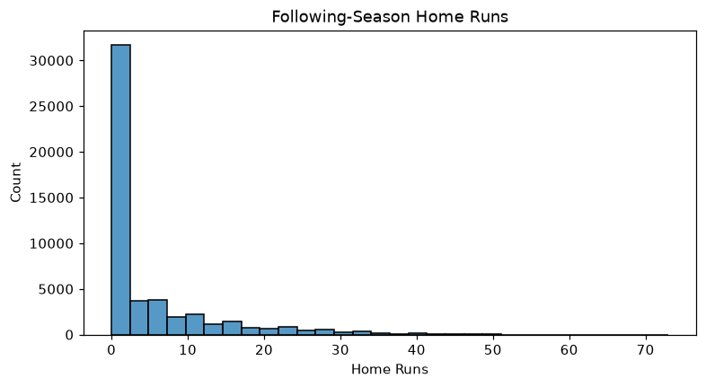

# Baseball Data Wrangling and Next Season Home Run Prediction

Individual academic project · Ngee Ann Polytechnic · Data Wrangling · Semester 3 folder, April 2026 coursework

## Analytical problem

Can a player's current batting performance, age, batting hand and All-Star selection help estimate home runs in the following calendar season? This historical sports study demonstrates joins, feature preparation and baseline comparison relevant to data analytics work.

## Methodology

1. Inspect batting, player and All-Star tables. Aggregate team stints to one player-season row without turning entirely missing totals into zero.
2. Shift a helper table by one calendar year to align the next-season target. Exclude unknown outcomes and restrict predictor seasons to 1933–2014.
3. Join player attributes and All-Star flags, derive age, and split data 75/25 with `random_state=0`.
4. Fit median/mode imputation, percentile caps, Yeo–Johnson transformations and scaling using training data. Compare linear regression on original, capped, transformed and combined features against a training-mean baseline.

Tools: Python, pandas, NumPy, scikit-learn, matplotlib and seaborn.

## Findings recorded in the original notebook

| Approach | Test RMSE | Test R² |
| --- | --- | --- |
| Training-mean baseline | 8.1024 | -0.0002 |
| Linear regression, original values | 4.8125 | 0.6471 |

The original-value model performed best in the submission; removing the influence of extreme performances did not automatically help. Metrics above are the original recorded findings and are not replaced with new-environment results.

## Files and reproduction

[analysis.ipynb](analysis.ipynb) retains the original code and analytical narrative; assignment header, stored outputs and execution metadata were removed. See [requirements.txt](requirements.txt) and [validation notes](docs/VALIDATION.md).

```bash
python -m venv .venv
# Windows PowerShell:
.venv\Scripts\Activate.ps1
python -m pip install -r requirements.txt
python -m jupyterlab
```

Start JupyterLab in the repository root. Supply `datasets/csv/batting.csv`, `datasets/csv/player.csv` and `datasets/csv/all_star.csv` from the original course dataset. The local folder is named `CSV`; use lowercase `csv` here for compatibility on case-sensitive systems. Dataset extracts are omitted because redistribution rights and the exact upstream version are unverified. They were available for local validation. Expected columns and joins are visible in the opening notebook cells.

## Limitations

The random split mixes historical periods and may contain the same player in train and test; it is not an out-of-time forecasting test. Only players with a known following-year outcome are included, creating selection bias. Linear regression can predict negative counts. Historical performance and this dataset do not establish investment, trading or production forecasting ability. The notebook narrative includes the original assessment and suggested future work.

## Analysis preview



Generated from the original plotting code during validation; the skewed target motivates careful baseline comparison.
